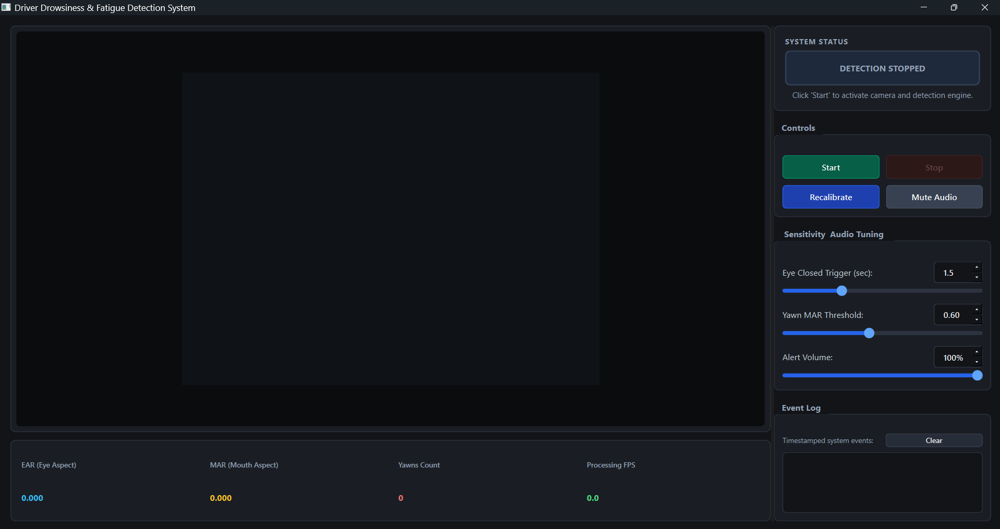
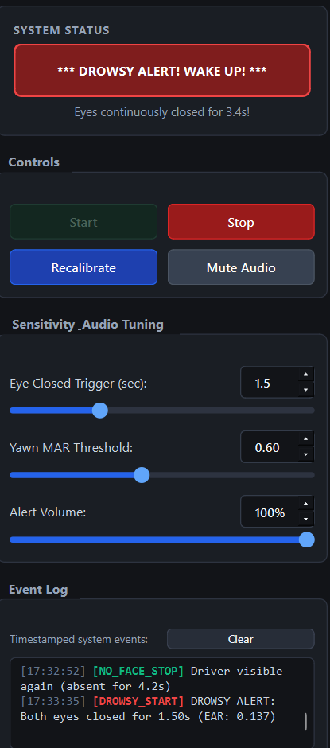
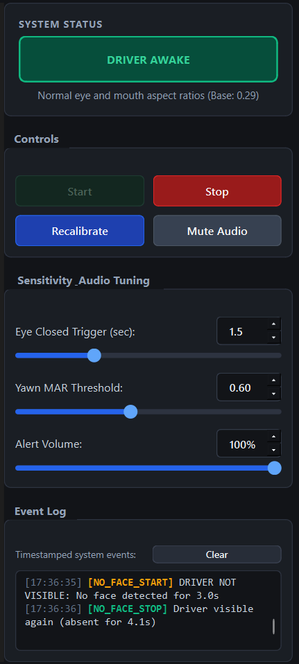
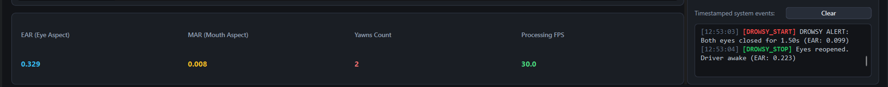

# Real-Time Driver Drowsiness & Yawn Detection

A real-time driver-monitoring system that watches a webcam feed, detects **sustained eye closure** and **yawning** from facial landmarks, and raises escalating audio alerts. It runs on a normal laptop CPU with a standard webcam: no GPU and no special hardware.

Built with Python, OpenCV, MediaPipe and PySide6.



| Drowsy alert | Driver not visible | Yawn detected |
|---|---|---|
|  |  |  |

---

## Why this project

Driver fatigue is a recognised contributing factor in road accidents, and long-haul trucking means long, monotonous hours behind the wheel, including on Indian highways. Commercial driver-monitoring systems exist, but they rely on dedicated hardware. This project explores how far a single standard webcam and a CPU-only machine can go.

## Features

- **Eye-closure detection:** a siren plays when both eyes stay closed for 1.5 seconds (adjustable)
- **Yawn detection:** counts yawns (mouth wide open for 1.2 seconds or more) and ignores talking and smiling
- **Fatigue warning:** a double beep and an on-screen message after 3 yawns within 10 minutes
- **Driver-not-visible safeguard:** if the face is lost for 3 seconds, a warning beep repeats; after 8 seconds the full siren plays
- **Per-user calibration:** a 3-second startup calibration adapts thresholds to each person, their glasses and their camera angle
- **Two ways to run:** a PySide6 desktop app, or a command-line version with an on-video display
- **Runs on CPU:** about 11 ms of processing per frame; live frame rate is set by the webcam (15–30 FPS observed)

## How it works

```
Webcam frame → horizontal flip → MediaPipe FaceLandmarker → EAR + MAR → timers & rules → audio + UI alerts
```

**Eye Aspect Ratio (EAR)** measures how open an eye is, from six landmarks around it:

```
EAR = (|p2 − p6| + |p3 − p5|) / (2 · |p1 − p4|)
```

**Mouth Aspect Ratio (MAR)** is the same idea for the inner lips: the average of three vertical lip distances divided by the mouth width.

**Decision rules**

| Condition | Rule | Response |
|---|---|---|
| Eyes closed | **Both** eyes below the threshold, continuously for 1.5 s | Siren until the eyes reopen |
| One eye closed, blinking | Ignored | None |
| Yawn | MAR ≥ 0.60 for ≥ 1.2 s (real time, not frames) | Yawn counter +1 |
| Repeated yawns | 3 yawns within 10 minutes | Double beep + on-screen warning |
| Face lost | No face for ≥ 3 s | Warning beep every 5 s |
| Face lost, prolonged | No face for ≥ 8 s | Full siren |

**Calibration.** For the first 3 seconds the system measures the user's open-eye EAR and closed-mouth MAR. The eye-closed threshold is set to 68% of the user's own open-eye baseline, so it adapts to different faces, glasses and camera angles. The yawn threshold is a fixed MAR of 0.60.

All timers use real elapsed time rather than frame counts, so the alert delay stays consistent whether the camera runs at 10 or 30 FPS. Audio is synthesised in code with NumPy and played through `pygame.mixer` on separate channels, so it never slows the video loop.

## Design decision: why landmarks instead of a CNN

My first version classified eye crops as open or closed with a CNN. It looked good in training and failed on a live webcam, so I replaced it. This is the most useful lesson in the project.

**What I built first.** A MobileNetV2 transfer-learning classifier, trained on a 20,000-image balanced subset of the MRL Eye Dataset (86,350 images in total). Validation accuracy was **96.7%** (precision 98.6%, recall 95.1%).

**What went wrong.** On live webcam frames it labelled clearly open eyes as closed, and in a backlit room it labelled closed eyes as open, often with high confidence. The MRL dataset is **infrared, grayscale, close-up eye crops**. A color webcam crop of a face is a different kind of image (a domain shift), so the validation score did not carry over to real use. The score also came from a random split of a dataset with repeated subjects, which likely overstates it.

**What I tried.** Feeding the same live eye crop to the model in different formats showed how sensitive it was:

| Same live open-eye crop | Model score (open = 1) |
|---|---|
| Raw color (BGR) | 0.12 → read as closed |
| Raw color (RGB) | 0.27 → read as closed |
| Converted to 3-channel grayscale | 0.91 → read as open |

Grayscale conversion and CLAHE contrast equalisation helped on single frames, but live testing still produced wrong labels in both directions.

**What I did instead.** I replaced the CNN with landmark geometry (EAR), which does not depend on training data or color. Per-frame processing dropped from about **163 ms to about 11 ms**. The CNN code and the trained model stay in the repo as the experiment that led to this design (`src/train_eye_model.py`, `--show-cnn`), but they are not used for any decision.

## Test results

Tested live by one person (the author) on one Windows laptop webcam, wearing glasses.

| Test | Result |
|---|---|
| Normal blinks | No alert |
| One eye closed for 3 s | No alert |
| Both eyes closed for 2 s | Siren after 1.5 s; stops when the eyes reopen |
| Looking up or down with eyes open | Stays awake (EAR drops slightly but stays above threshold) |
| Talking for 5 s | No yawn counted (MAR about 0.10–0.25) |
| Smiling wide | No yawn counted (MAR about 0.16) |
| Deliberate yawn held about 2 s | Counted (MAR about 0.75–0.88) |
| 3 yawns | Fatigue warning beep and message |
| Face covered for 5 s / 10 s | Warning beep at 3 s / siren at 8 s; clears when the face returns |
| Brief face loss (1–2 s) | No alert |
| Backlit room (bright window behind the user) | Works |
| Dim room, uneven light | Works overall; one eye was noisier than the other |

Typical values: open-eye EAR about 0.24–0.34, closed-eye EAR about 0.05–0.15, closed-mouth MAR about 0.01, yawn MAR above 0.7.

## Limitations

- **Tested by one person on one webcam.** Behaviour on other faces, camera angles and cameras is untested.
- **It needs a visible face.** MediaPipe can guess the position of a covered eye, so a hand over one eye still reads as open. A hand over both eyes loses the face entirely. The driver-not-visible safeguard covers the second case but not the first.
- **Sunglasses were not tested.**
- **A visible-light webcam cannot see in true darkness.** Commercial systems use infrared cameras for night driving. Uneven lighting made one eye's reading noisy in testing.
- **EAR depends on head pose and camera angle.** The camera should sit roughly at eye level, facing the driver.
- **Calibration assumes eyes open and mouth closed** during the first 3 seconds.
- **Not tested in a moving vehicle**, and the thresholds were tuned on one face.
- **This is a demonstration and learning project, not a certified safety device.**

## Tech stack

- Python 3.13
- OpenCV: webcam capture and drawing
- MediaPipe (FaceLandmarker): facial landmarks
- NumPy: geometry and audio synthesis
- Pygame: audio playback
- PySide6 (Qt): desktop interface
- TensorFlow / Keras and scikit-learn (optional, CNN experiment only)

## Getting started (Windows)

```powershell
git clone https://github.com/Soundarya-Rao/drowsiness-detection-system.git
cd drowsiness-detection-system

python -m venv venv
.\venv\Scripts\Activate.ps1
pip install -r requirements.txt
```

If PowerShell blocks the activation script, run `Set-ExecutionPolicy -Scope Process -ExecutionPolicy Bypass` first.

**Run the desktop app**

```powershell
python app\main.py
```

**Run the command-line version**

```powershell
python src\drowsiness_detector.py
```

On first run the FaceLandmarker model (about 4 MB) downloads automatically into `models/`. For the first 3 seconds, look at the camera with your eyes open and your mouth closed while it calibrates.

**Controls.** In the desktop app: Start, Stop, Recalibrate, Mute, plus sliders for the eye-closed time, the yawn threshold and the volume. In the command-line version: `m` mutes or unmutes, `q` quits.

**Useful command-line options** (run with `--help` for the full list)

| Option | Default | Meaning |
|---|---|---|
| `--ear-ratio` | 0.68 | Eye-closed threshold as a fraction of your calibrated open-eye EAR |
| `--mar-threshold` | 0.60 | MAR above which the mouth counts as open for a yawn |
| `--yawn-seconds` | 1.2 | Time the mouth must stay open to count as a yawn |
| `--yawn-warning-count` | 3 | Yawns that trigger the fatigue warning |
| `--yawn-warning-window` | 600 | Window for that count, in seconds |
| `--no-face-seconds` | 3.0 | Face-lost time before the warning beep |
| `--no-face-alarm-seconds` | 8.0 | Face-lost time before the full siren |
| `--no-sound` / `--volume` | off / 1.0 | Disable audio / set the volume (0.0 to 1.0) |
| `--show-cnn` | off | Load the optional CNN experiment (needs `requirements-cnn.txt`) |

## Optional: reproduce the CNN experiment

```powershell
pip install -r requirements-cnn.txt
```

Download the datasets using the commands in [`data/README.md`](data/README.md), then:

```powershell
python src\prepare_data.py
python src\train_eye_model.py --max-samples 20000
```

The datasets are not included in this repository. The live application does not need them.

## Project structure

```
├── app/
│   └── main.py              PySide6 desktop application
├── src/
│   ├── engine.py            Detection logic: calibration, EAR/MAR, timers, alerts
│   ├── landmarks.py         MediaPipe wrapper, EAR/MAR computation
│   ├── audio_alerts.py      Synthesised siren and warning sounds
│   ├── drowsiness_detector.py   Command-line version
│   ├── train_eye_model.py   CNN experiment (not used for live decisions)
│   ├── prepare_data.py      Organises the downloaded datasets
│   └── test_sound.py, test_setup.py, landmark_test.py   Small check scripts
├── models/
│   └── eye_model.keras      CNN from the experiment
├── data/README.md           Dataset notes and download commands
├── docs/screenshots/
├── requirements.txt
└── requirements-cnn.txt
```

## Datasets

- **MRL Eye Dataset:** infrared eye images, used to train and evaluate the CNN experiment. Original source: [mrl.cs.vsb.cz/eyedataset](http://mrl.cs.vsb.cz/eyedataset). The exact Kaggle copy used is listed in [`data/README.md`](data/README.md).
- **Yawn / drowsiness image dataset (Kaggle):** used only to sanity-check the MAR threshold on sample images. It is not used to train anything in the live system.

## Ideas for future work

- Test across more people, cameras and lighting, and report accuracy per condition
- Add head-pose estimation to catch head nodding and reduce angle sensitivity
- Add a percentage-of-eye-closure measure over a rolling time window
- Support an infrared camera for night use
- Package as a standalone Windows executable, or port to an embedded device
- Log events to a file for later review

---

Built by Soundarya Govinda Rao.
